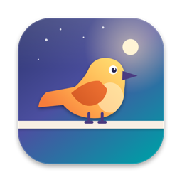
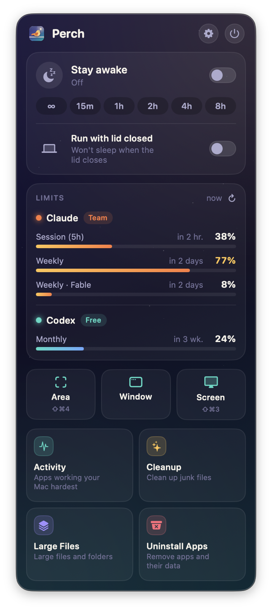
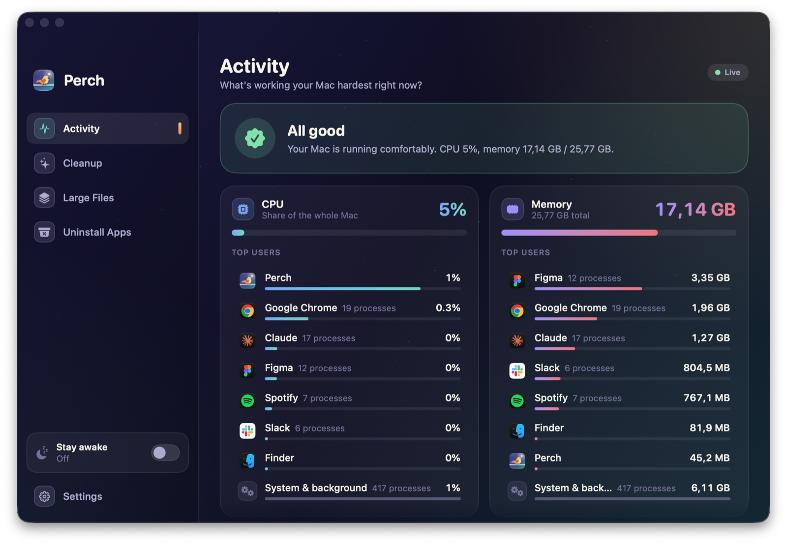
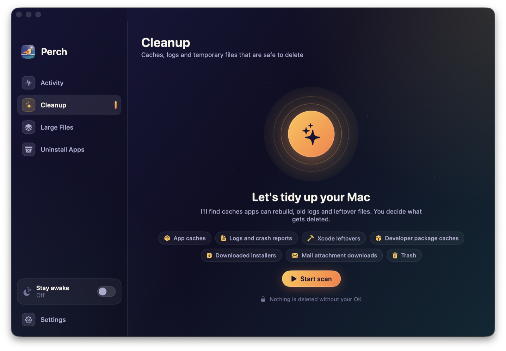
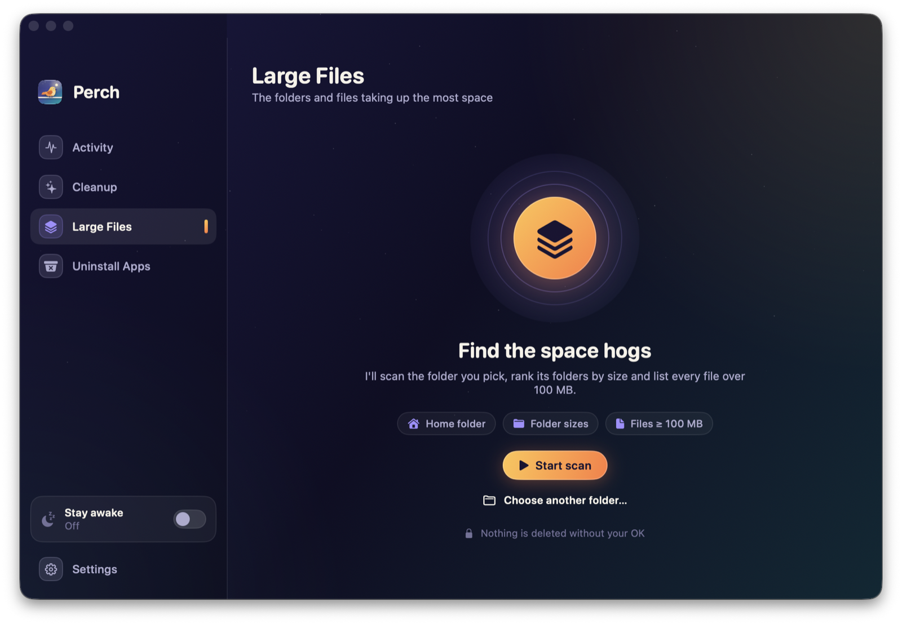

<p align="center">
  
</p>

<h1 align="center">Perch</h1>

<p align="center">
  <b>A tiny, native menu bar companion for your Mac.</b><br>
  Stay awake · AI usage limits · Screenshot stack · Cleanup · Large files · Uninstaller · Activity
</p>

<p align="center">
  
  
  
  
</p>

---

Perch replaces a handful of single-purpose utilities with one small app that lives in your menu bar. It keeps the parts people actually use from Amphetamine, CleanShot, CleanMyMac, Pearcleaner and Activity Monitor, drops the rest, and does nothing in the background unless you ask it to.

<p align="center">
  
</p>

## Features

### ☀️ Stay awake
- One switch to keep your Mac awake: indefinitely or for 15 min, 1, 2, 4 or 8 hours.
- Optionally keep the display on too.
- **Run with the lid closed**, with no external display required (`pmset disablesleep`). One admin prompt the first time, then it's passwordless via a sudoers rule scoped to exactly two commands. The setting is **always restored when Perch quits**.
- The switch updates instantly and rolls back with an error if something fails. It also detects other clamshell tools (Amphetamine, Vorssaint…) that keep reverting it.

### 📊 AI usage limits
- **Claude Code**: 5-hour session, weekly, and per-model weekly windows.
- **Codex**: primary and secondary rate-limit windows.
- Reset times and colour-coded bars. Optionally shows the Claude session % next to the menu bar icon.
- Reads the logins the CLIs already store on your Mac. Tokens are never refreshed, copied or written anywhere.

### 📸 Screenshot stack
- **⇧⌘4** captures an area (press Space to pick a window); **⇧⌘3** captures the full screen. Both shortcuts are rebindable.
- Every capture is **copied to the clipboard** and lands in a **stack in the bottom-left corner**:
  - **Copy**, **Save** (to a folder you choose), **Save As…**, or **drag & drop** anywhere.
  - Double-click to open, × to dismiss.
- The stack animates in from the bottom, slides away to the left, and fades out while you take the next shot.

### ✨ Cleanup
Finds files that are **safe to delete**: app caches, logs and crash reports, Xcode DerivedData and old device support, developer package caches (npm, pnpm, yarn, bun, Gradle, pip, Cargo, CocoaPods…), downloaded installers, Mail downloads and the Trash. Pick categories or single items, then move them to the Trash or delete them permanently.

### 🗂 Large files
Scans any folder with `fts(3)`. Drill into folders ranked by size, or list every file over 100 MB. Then reveal or trash what you don't need.

### 🗑 Uninstall apps
Lists your apps and finds what each one leaves behind: Application Support, caches, preferences, containers, group containers, saved state, launch agents and daemons, helper tools, install receipts. You choose which files go; the app is quit first if it's running.

### 📈 Activity
A plain-language answer to "why is my Mac slow?":
- A one-line verdict at the top.
- Top CPU and memory users, with helper processes **grouped into their app** (16 Chrome helpers become one Chrome row).
- One-click quit.

<p align="center">
  
</p>

<p align="center">
  
  
</p>

## Design principles

- **Native and dependency-free.** Swift + SwiftUI + AppKit, built with SwiftPM. No Electron, no frameworks to download.
- **Idle means idle.** No timers or polling at rest:
  - Usage limits are fetched when you open the menu.
  - The Activity sampler runs only while its tab is visible.
  - Scans start only when you press *Start scan*.
- **Memory is released.** The menu and the window build their views on open and drop them, including scan results, on close. Thumbnails are downsampled. A typical idle footprint is ~50 MB.
- **Nothing is deleted without your OK.** Every destructive action asks first and moves to the Trash by default.
- **Its own look.** "Dusk" is a small design system taken from the app icon: night-indigo surfaces, amber accents and rounded type. It replaces stock controls everywhere.

## Install

### Download

Grab the latest **Perch-x.y.z.zip** from [Releases](https://github.com/mfrkankaya/perch/releases), unzip it and move **Perch.app** to `/Applications`. Builds are universal (Apple Silicon + Intel).

> [!IMPORTANT]
> Builds aren't notarized yet, so macOS blocks the first launch. Right-click Perch.app → **Open**, or run `xattr -dr com.apple.quarantine /Applications/Perch.app`.

### Build from source

Requirements: **macOS 14 Sonoma or later** and Xcode 16+ (or a Swift 5.10+ toolchain).

```bash
git clone https://github.com/mfrkankaya/perch.git
cd perch
./scripts/build.sh --install   # builds, signs and copies Perch.app to /Applications
```

`./scripts/build.sh` alone produces `build/Perch.app`; `./scripts/build.sh --release` makes a universal `build/Perch-<version>.zip`.

The script signs with your first *Apple Development* / *Developer ID* identity, if you have one. A stable signature keeps macOS privacy permissions (like Screen Recording) across rebuilds. Without one it falls back to ad-hoc signing.

## Permissions

| Permission | Why | When |
|---|---|---|
| **Screen Recording** | Taking screenshots | Asked on the first capture |
| **Full Disk Access** *(optional)* | Lets Cleanup, Large Files and Uninstall see protected folders (Photos library, Mail, other apps' containers). Without it, those folders are skipped silently instead of triggering a prompt for each one. | Settings → Full Disk Access |
| **Administrator** *(once)* | Lid-closed mode needs `pmset disablesleep`. The first toggle installs `/etc/sudoers.d/perch`, which allows only `pmset -a disablesleep 0` and `pmset -a disablesleep 1`. | First time you enable lid mode. You can remove the rule in Settings. |

## Privacy

Perch has no analytics, no telemetry and no update pings. The only network requests it ever makes are the two usage calls below, and only when the menu is open (or every 5 minutes if you enable the menu bar percentage):

| Service | Credentials read from | Endpoint |
|---|---|---|
| Claude Code | Keychain item `Claude Code-credentials` (via `/usr/bin/security`, so no Keychain prompt), or `~/.claude/.credentials.json` | `GET https://api.anthropic.com/api/oauth/usage` |
| Codex | `~/.codex/auth.json` (or `$CODEX_HOME`) | `GET https://chatgpt.com/backend-api/wham/usage` |

> [!NOTE]
> Both endpoints are undocumented and may change. If a session has expired, run `claude` or `codex` once and Perch picks up the fresh login.

## Usage tips

- `open -a Perch --args --tab activity` opens the window on a specific tab (`activity`, `cleanup`, `disk`, `apps`, `settings`).
- **⌘Q** only closes the window; Perch stays in the menu bar. Use **⌥⌘Q** or the power button to quit completely.
- If macOS's own **⇧⌘3 / ⇧⌘4** shortcuts are still on, they take precedence. Turn them off in *System Settings › Keyboard › Keyboard Shortcuts › Screenshots*, and Perch will show a warning in Settings until you do.
- Language follows the system (English or Turkish) and can be switched live in Settings.

## Project structure

```
Sources/Perch
├── App.swift            App entry, menu bar item and the floating menu panel
├── MenuView.swift       Menu bar panel content
├── MainWindow.swift     Main window, tabs and sidebar
├── Power.swift          Stay awake (IOPM assertions) and lid-closed mode (pmset)
├── Usage.swift          Claude / Codex limit fetching
├── Screenshot.swift     Global hotkeys (Carbon), capture, screenshot stack
├── Cleaner.swift        Safe-to-delete categories and cleanup
├── DiskUsage.swift      fts(3) scanner and size tree
├── Uninstaller.swift    App list and leftover matching
├── Activity.swift       libproc sampler and per-app grouping
├── Loc.swift            Lightweight live localisation (TR → EN table)
├── Shared.swift         Formatting, shell and file-system helpers
└── UI/                  "Dusk" design system and the window's screens
scripts/
├── build.sh             Build, bundle, sign (and optionally install)
└── make-icon.swift      Renders the app icon and AppIcon.icns from code
```

## Contributing

Issues and pull requests are welcome. A few guidelines:

- Keep it **dependency-free** and **idle-friendly**: no background work the user didn't ask for.
- New UI should use the components in `UI/Theme.swift` (`DuskCard`, `DuskButton`, `DuskCheck`, `PillSwitch`…) rather than stock controls.
- User-facing strings go through `L("…")`. Add the English translation to `Loc.swift`.
- Anything that deletes files must confirm first and default to the Trash.

## Acknowledgements

Perch was inspired by the ideas behind
[Amphetamine](https://apps.apple.com/app/amphetamine/id937984704),
[CleanShot X](https://cleanshot.com),
[CleanMyMac](https://macpaw.com/cleanmymac),
[Pearcleaner](https://github.com/alienator88/Pearcleaner)
and OpenUsage. It shares no code with any of them.

## License

TBD. A license will be added before the first public release.
